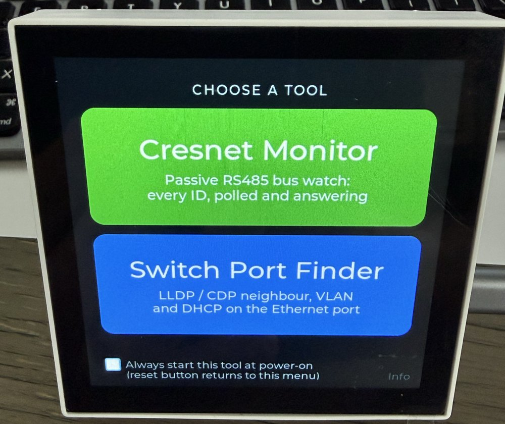
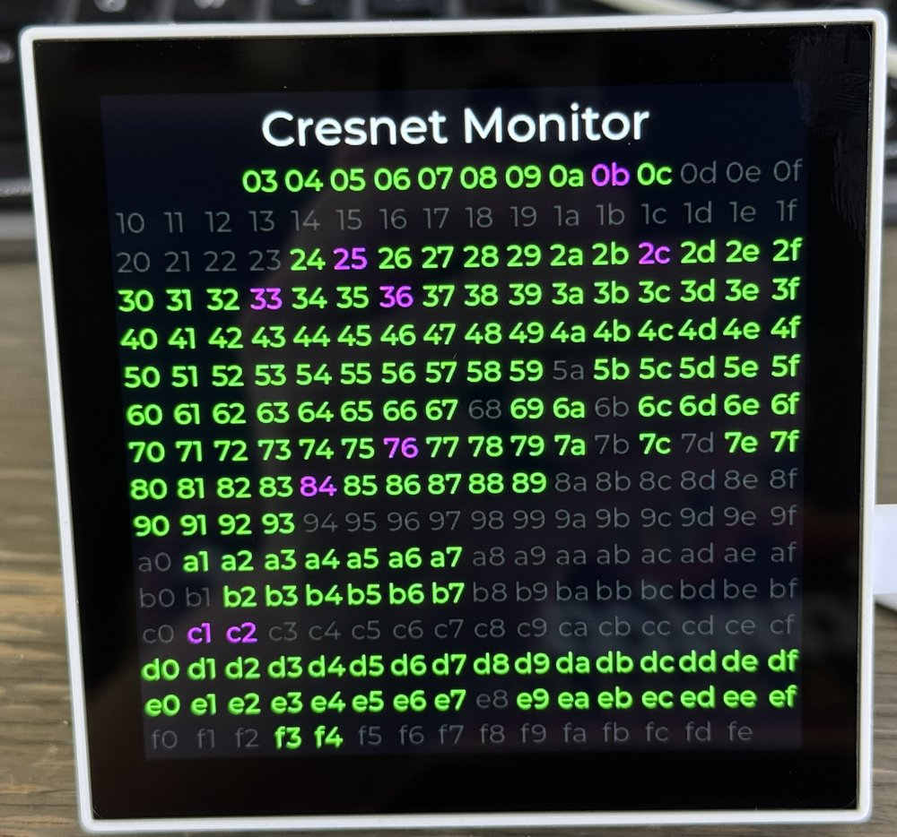
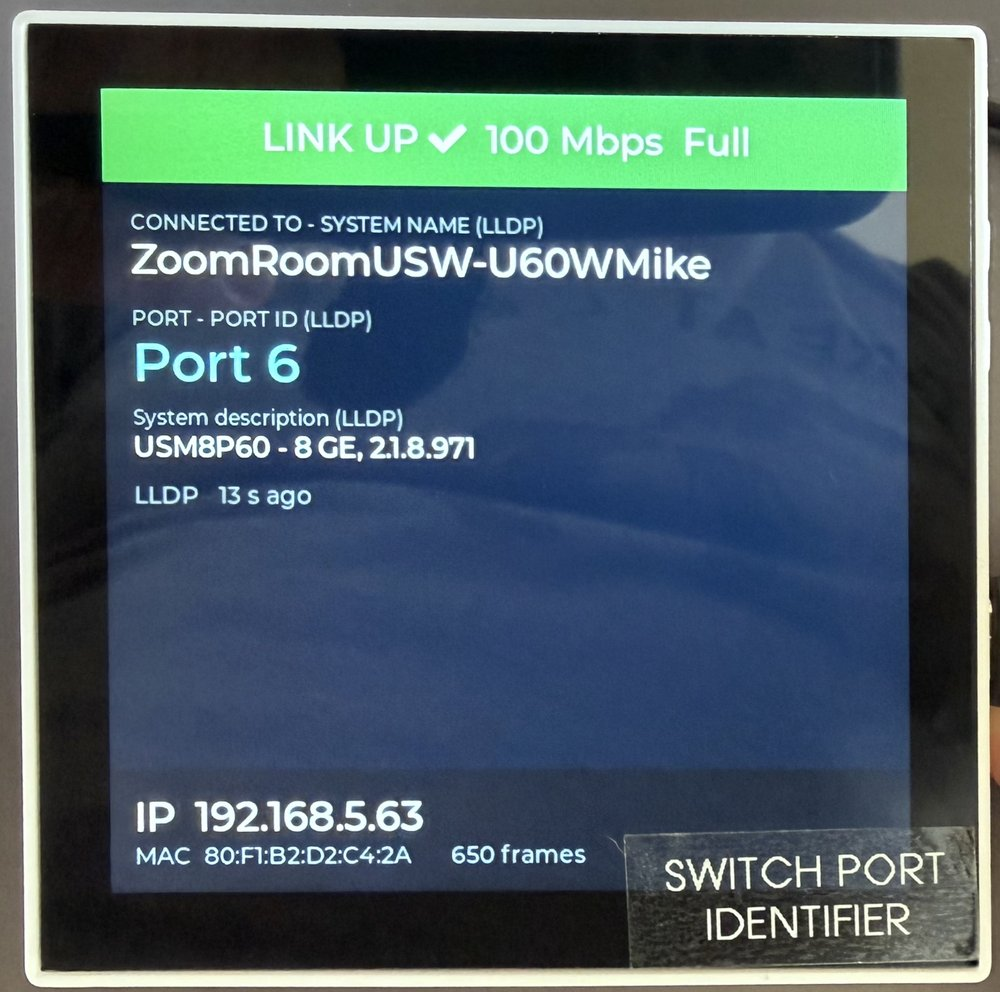

# LinkScout

**A two-tool field kit for AV and network installers**, on a Waveshare ESP32-P4 wall panel.

<table>
  <tr>
    <td align="center" width="33%"></td>
    <td align="center" width="33%"></td>
    <td align="center" width="33%"></td>
  </tr>
  <tr>
    <td align="center"><b>Pick a tool at boot</b></td>
    <td align="center"><b>Cresnet Monitor</b><br>every ID: polled, answering, or gone quiet</td>
    <td align="center"><b>Switch Port Finder</b><br>which switch and port this jack lands on</td>
  </tr>
</table>

When the panel boots, it shows two large buttons. The tool you tap runs until the next power
cycle:

| Tool | Answers | Connects via |
| --- | --- | --- |
| **Cresnet Monitor** | Which Cresnet IDs does the control processor poll, and which of them answer? | The panel's built-in RS485 terminal |
| **Switch Port Finder** | Which switch, port and VLAN is this wall jack patched to? | The panel's RJ45 Ethernet port |

Tap the dim **Info** label in the lower-right corner of the menu to see the build date, the
author and the open-source notices.

To switch tools, press the panel's reset button or power-cycle it. Each tool takes over
hardware that it doesn't release: the UART interrupt for one, the Ethernet receive path for
the other.

**Always start this tool at power-on.** Tick this box on the menu, then pick a tool. From
then on, the panel skips the menu at power-on and goes straight into that tool, which suits
a unit left in place. To get the menu back, **press the reset button**. The menu then shows
the box still ticked; untick it to go back to choosing at every boot. The saved choice is
kept in flash (NVS), so it survives power-offs. Installing a release (either way below)
clears it, so after an update the menu shows at power-on until you choose again.

The ESP32-P4 itself can't tell a reset-button press from a power-up: both report the same
reset reason, and both clear its low-power memory. The board's audio codec isn't wired to
the reset line, so at each boot the firmware leaves a marker in two of the codec's unused
volume registers. If the marker is still there at the next boot, the reset button was
pressed; a power-off clears it. Crashes, watchdog resets and brownouts go back into the saved
tool. If the codec can't be read, the panel shows the menu so you can never get locked out of
it.

## Cresnet Monitor

A **passive** Cresnet bus monitor. It listens to the bus and never transmits. It shows every
possible Cresnet ID as a 16×16 hex grid, coloured by what the control processor is doing with
it:

| Colour | Meaning |
| --- | --- |
| Green | Responding to polls |
| Yellow | Was responding; the latest poll went unanswered |
| Red | Was responding earlier, silent for the past minute |
| Magenta | Polled, but never seen to respond since the panel started |
| Dark grey | Not currently polled |

Tap the grid to show this legend on the panel. If no bus traffic is seen for 5 seconds, a
**Master Offline** plate appears with a wiring reminder.

IDs `00`, `01`, `02` (master side) and `FF` (broadcast) are never peripherals and get no
cell.

**Wiring.** Cresnet's data pair is RS485 at 38400 baud, 8N1, and the panel's bottom board
has an isolated, automatic-direction RS485 port on its 4-pin power terminal (UART1, RX
GPIO48, TX GPIO47). The firmware never transmits, so the port only listens.

The recommended hookup is all four Cresnet conductors, so the panel runs from the Cresnet
supply on a single cable:

| Cresnet | Panel terminal |
| --- | --- |
| **Y** (data A) | pin 1, **RS485 A** |
| **Z** (data B) | pin 2, **RS485 B** |
| **G** (ground) | pin 3, **GND** |
| **24** (+24 V) | pin 4, **+12–24 V** |

The panel's draw comes out of that Cresnet power budget like any other device on the bus.
If you'd rather not load it, connect only Y and Z and power the panel from its USB-C port.
In that case leave pin 3 unconnected: it's the power input's ground, not a signal ground
for the RS485 port, which is isolated.

> **Termination.** The bottom board has a 120 Ω terminating resistor fitted across A–B,
> with no jumper to disable it, so connecting the panel adds a termination wherever you
> clip in. In practice Cresnet keeps working with it there: by RS485 standards a Cresnet run
> is under-terminated, and one 120 Ω load doesn't upset it. If you'd rather the panel didn't
> load the bus, the resistor can be removed: see below. Do that at your own risk; it's a
> permanent change to the board.

### Removing the terminating resistor (optional)


1. **Unplug the panel**, then separate its two halves. Use a thick flathead screwdriver
   that fills as much of the tab slot as possible, and give it a gentle twist. A narrow
   blade concentrates the force and tends to mar or scratch the tab.
2. On the **bottom board** ("86 Panel Bottom Board" on the silkscreen), look at the side
   with the terminal blocks, not the side that faces the screen. Find the 4-pin power and
   RS485 terminal. Beside its **A** and **B** pins are two identical fuses marked **JF**.
3. The resistor is just past those fuses, toward the edge of the board. The photo shows
   that spot **after** the resistor was removed: the circle marks its two empty pads. The
   part is **very small**: about 1 mm long and half a millimetre wide, with no reference
   designator on the board and no marking on the part, even under magnification. Use a
   magnifier and a good light.
4. To confirm it's the right part, measure across it with an ohmmeter: it reads 120 Ω.
   Then remove it, with fine tweezers or a soldering iron, or by carefully breaking it off.
   Afterwards A–B should no longer measure 120 Ω. The bias resistors on A and B mean it
   won't read open.

<br clear="right">

How the protocol is decoded comes from watching a live bus: the master polls with
`<ID> 00`, and a peripheral answers with a length-prefixed message about a millisecond later.
The full timing analysis is in the header comment of [`cresnet_monitor.cpp`](cresnet_monitor.cpp).

## Switch Port Finder

Listens on the Ethernet port for the two discovery protocols switches use to announce
themselves:

- **LLDP** (IEEE 802.1AB)
- **CDP** (Cisco Discovery Protocol)

It shows what the switch reports about the port you're plugged into: switch name, port name,
port description, VLAN, management address, platform and software version. Every value is
labelled with the protocol field it came from, because switch vendors produce some cryptic
strings. The panel also requests a DHCP lease and shows the address it gets, the panel's MAC
address, and a live link band (speed and duplex).

Behaviour worth knowing:

- **Switches advertise every 30–60 seconds**, so expect a short wait after plugging in.
- **Stale data turns grey.** When the link drops, everything learned from it stays on screen
  in grey. It returns to full colour only when it's learned again on the new link.
- **Receive-only.** The panel doesn't send LLDP or CDP, so it won't appear in the switch's
  neighbour table.
- **Unmanaged switches** usually send neither protocol, so the panel stays on "Listening for
  LLDP / CDP". DHCP and link state still work.

How it works: after `ETH.begin()`, the sketch replaces the Ethernet driver's stack-input
callback with a tap. The tap decodes LLDP/CDP frames and passes every frame on to lwIP
unchanged, so DHCP keeps working. See [`ethsniff.cpp`](ethsniff.cpp) and
[`neighbor.cpp`](neighbor.cpp).

## Hardware

**Waveshare ESP32-P4-86-Panel-ETH-2RO**: an 86 × 86 mm wall-box panel with a 720×720 touch
display. Its bottom board carries the RJ45 Ethernet jack, an isolated RS485 port, two relays
and a 12–24 V power input. Nothing else is needed: no external transceiver, no adapters.

> **Check the SKU: you need the `-ETH-2RO` model.** Waveshare also sells this panel
> without the bottom board, so with **neither Ethernet nor RS485**. That model's name
> leaves out `ETH`, and it's typically listed as the version with a **camera** port.
> **Neither tool works on it**: the Switch Port Finder needs the Ethernet jack, and the
> Cresnet Monitor needs the RS485 port. The firmware will install and show its menu, but
> there's nothing for either tool to listen to.

## Installing: one click

> [!WARNING]
> **Clicking the link below starts flashing the panel almost straight away, without asking
> "are you sure?".** Once you pick the port after **Connect**, the launchpad erases the
> **entire** flash, including whatever firmware is on the panel now and anything it had
> stored, and writes LinkScout. Make sure the port you pick is the panel you mean to
> overwrite.

In **Chrome or Edge on a desktop computer** (these browsers can talk to USB serial ports;
Firefox and Safari can't):

1. Plug the panel's **USB-C** port into the computer with a USB **data** cable (some cables
   only charge).
2. Open **[LinkScout in ESP Launchpad](https://espressif.github.io/esp-launchpad/minimal-launchpad/?flashConfigURL=https://raw.githubusercontent.com/chipguyhere/LinkScout/main/launchpad.toml)**
   (this erases the whole panel: see the warning above).
3. Click **Connect** and pick the panel's port (*USB-SERIAL CH340* or similar). It erases the
   chip and writes the newest firmware straight from this repository; there's nothing to
   download first. Erasing all 32 MB takes a while, so give it a few minutes.
4. Press the panel's **reset** button, or unplug it and plug it back in.

If the launchpad won't connect, hold **BOOT**, press and release **RESET**, let go of BOOT
and try again, or use one of the methods below.

## Installing: web flasher or esptool

The image is [`linkscout.bin`](linkscout.bin) in this repository: bootloader, partition table
and app in one file, written at address **0x0**.

**Web flasher**, in the same browsers: open <https://espressif.github.io/esptool-js/>, click
**Connect**, pick the panel's port, set **Flash Address** to `0x0`, choose `linkscout.bin`
and click **Program**.

**esptool**:

```sh
esptool --chip esp32p4 --port /dev/cu.wchusbserial* write-flash 0x0 linkscout.bin
```

(Older esptool versions spell the command `esptool.py … write_flash`.) On Windows the port is
a `COMx`. On most computers the CH340 USB-serial chip works without a driver; older Windows
versions may need WCH's CH340 driver. Serial diagnostics are printed at 115200 baud on the
same port.

## Building from source

Requires the Arduino IDE or `arduino-cli`, with:

| Dependency | Version used | Where |
| --- | --- | --- |
| esp32 core (Espressif) | 3.3.11 (ESP-IDF 5.5.5) | Boards Manager |
| `lvgl` | 9.5.0 | Library Manager |
| `chipguy_P486Panel_480display` | 1.0.0 | [`libraries/`](libraries) in this repository |
| `chipguy_P486Panel_touch` | 1.0.0 | [`libraries/`](libraries) in this repository |

The sketch folder carries its own `lv_conf.h`, so you don't need a global LVGL
configuration. In the Arduino IDE, copy the two folders in `libraries/` into your Arduino
`libraries` folder. With arduino-cli, point `--libraries` at them as below.

**Arduino IDE board settings:** Board **ESP32P4 Dev Module**, PSRAM **Enabled**, Flash Size
**32MB (256Mb)**, USB CDC On Boot **Enabled**.

**arduino-cli:**

From the folder that contains your clone:

```sh
FQBN="esp32:esp32:esp32p4:PSRAM=enabled,FlashSize=32M,CDCOnBoot=cdc"
arduino-cli compile --fqbn "$FQBN" --libraries LinkScout/libraries LinkScout
arduino-cli upload  --fqbn "$FQBN" -p /dev/cu.wchusbserial* LinkScout
```

To make a release image, run `python3 make_release.py`. It compiles the sketch and merges
the parts into `linkscout.bin`. The core's own `.merged.bin` is padded to the full 32 MB;
this one stops at the end of the app. The script also keeps your own directory names out of
the image: `assert()` and log messages otherwise embed full source paths, so it remaps them
at compile time and refuses to write an image that still contains your home directory.

## Source code and rebuilding

This repository is the complete source for the firmware: the sketch, plus the two
`chipguy_P486Panel_*` libraries in [`libraries/`](libraries), which aren't published
anywhere else. All the other dependencies are unmodified public releases at the versions
listed above and in `BUILD_INFO.txt`. With this source you can rebuild the firmware,
including against a modified Arduino-ESP32 core, as the core's LGPL-2.1 license allows.

Each release is packaged with [`make_repo_zip.py`](make_repo_zip.py):

```sh
python3 make_release.py     # builds linkscout.bin
python3 make_repo_zip.py    # writes dist/LinkScout-YYYYMMDD.zip
```

The zip mirrors this repository exactly: sketch, libraries, docs, notices, `linkscout.bin`,
`launchpad.toml`, `BUILD_INFO.txt` and `.gitignore`. Its contents are what gets committed,
and the zip itself is attached to the GitHub release as the source matching that binary.
The script refuses to run if `linkscout.bin` is older than any source file or contains a
local path. It also stops if any file looks like it holds a credential (passwords, keys,
certificates, Wi-Fi/MQTT settings).

## Credits

Written by **Michael Caldwell-Waller** — [github.com/chipguyhere](https://github.com/chipguyhere).

## License

The sketch is MIT licensed; see [LICENSE](LICENSE). The firmware also contains third-party
components under their own licenses; see [THIRD_PARTY_NOTICES.md](THIRD_PARTY_NOTICES.md) and
[`LICENSES/`](LICENSES). Ship both with any copy of the binary.

Crestron and Cresnet are trademarks of Crestron Electronics, Inc. Cisco and CDP are
trademarks of Cisco Systems, Inc. This project is not affiliated with or endorsed by either
company. Cresnet support comes from passively observing bus traffic.
