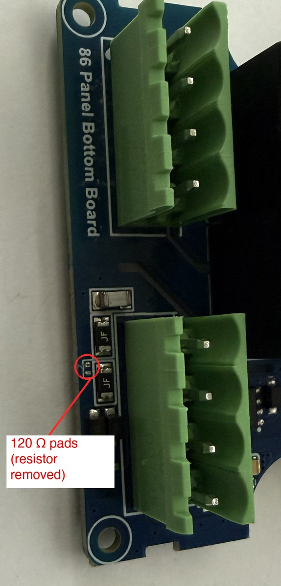

# Removing the terminating resistor

The panel's bottom board has a 120 Ω terminating resistor fitted across the RS485 A–B pair,
with no jumper to disable it. Connecting the panel to Cresnet therefore adds a termination
wherever you clip in. In practice Cresnet keeps working with it there: by RS485 standards a
Cresnet run is under-terminated, and one 120 Ω load doesn't upset it.

Most people can leave it alone. If you'd rather the panel didn't load the bus, the resistor
can be removed. **Do this at your own risk**: it's a permanent change to the board.

1. **Unplug the panel**, then separate its two halves. Use a thick flathead screwdriver
   that fills as much of the tab slot as possible, and give it a gentle twist. A narrow
   blade concentrates the force and tends to mar or scratch the tab.
2. On the **bottom board** ("86 Panel Bottom Board" on the silkscreen), look at the side
   with the terminal blocks, not the side that faces the screen. Find the 4-pin power and
   RS485 terminal. Beside its **A** and **B** pins are two identical fuses marked **JF**.
3. The resistor is just past those fuses, toward the edge of the board. The photo shows
   that spot **after** the resistor was removed: the circle marks its two empty pads. The
   part is **very small**: about 1 mm long and half a millimetre wide, with no reference
   designator on the board and no marking on the part, even under magnification. Use a
   magnifier and a good light.
4. To confirm it's the right part, measure across it with an ohmmeter: it reads 120 Ω.
   Then remove it, with fine tweezers or a soldering iron, or by carefully breaking it off.
   Afterwards A–B should no longer measure 120 Ω. The bias resistors on A and B mean it
   won't read open.

 

[Back to the README](../README.md#cresnet-monitor)
